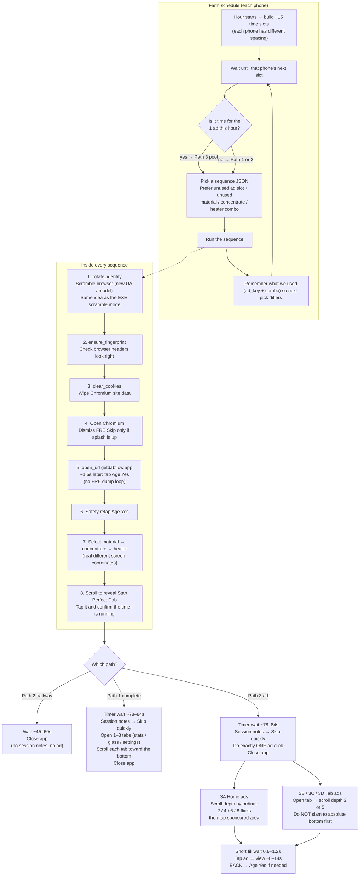

# FamFlow sequence logic (high-school level)

One **sequence** = one full run on one phone. The farm schedules ~**15 sequences per hour per phone**, spread through the hour (not all at once).

## Why ads used to look the same
We used to scroll **all the way to the bottom every time**, then tap near the same Y. That hits the same Sponsored unit. Now each ad ordinal uses a **different scroll depth**, and the farm **refuses recently used ad keys** (`home:0`, `stats:1`, etc.).

## Your notes

### What looks wrong?

### What should change?

### Ideas

